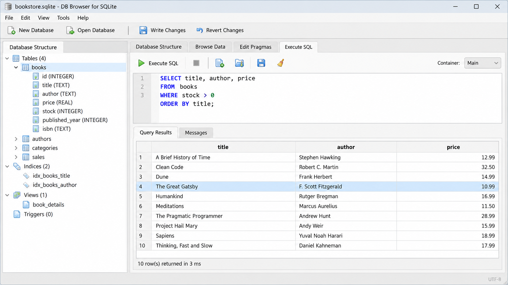
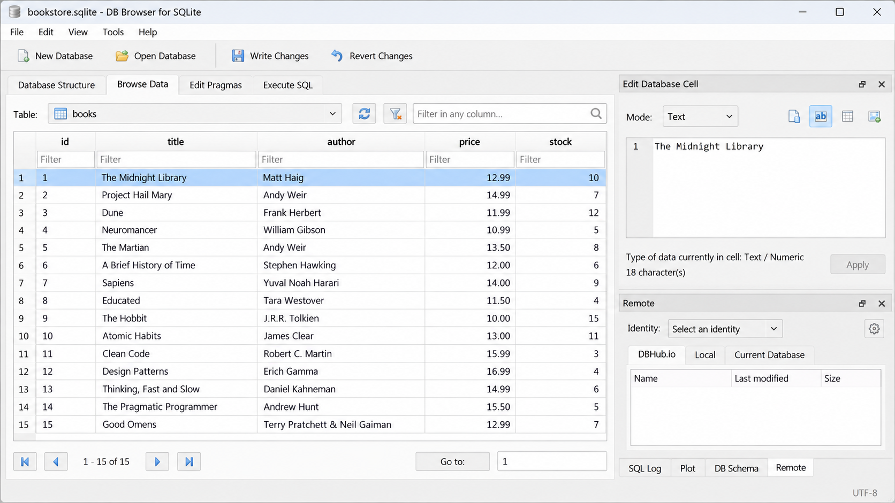
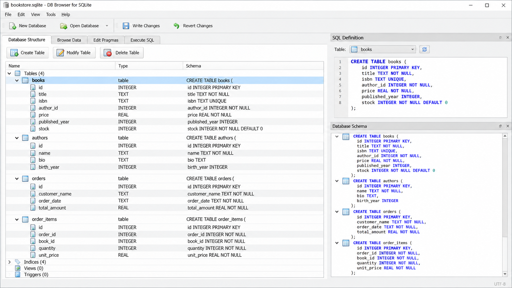

# DB Browser For SQLite - Visual SQLite Database Manager

## Table of Contents

- What it is
- What it is not
- Design goals
- Examples
- Windows
- macOS
- Linux
- SQLCipher
- Import and export
- Compiling
- Execute unit tests
- Architecture
- Support
- History
- Contributors
- License

## What it is

DB Browser For SQLite is a visual, open-source application for creating, designing, browsing, and editing SQLite database files. The DB SQLite Browser organization maintains DB Browser For SQLite as a focused database GUI built with C++ and Qt.



DB Browser For SQLite uses a familiar spreadsheet-style interface. Users can work with tables and records without learning every SQL command, while developers can still open the SQL editor and execute custom statements.

DB Browser For SQLite provides controls and dialogs to:

- Create and compact SQLite databases.
- Create, modify, and delete tables.
- Create, modify, and delete indexes.
- Browse, search, add, edit, and delete records.
- Filter and sort table data.
- Run SQL queries and inspect their results.
- Import records from CSV files.
- Export records and query results.
- Export databases as SQL dumps.
- Configure encrypted databases through SQLCipher.
- Plot simple graphs from table or query data.

[](https://db-sqlite-browser.github.io/db-browser-for-sqlite/SQLite-browser)

### Common Searches

db browser for sqlite, DB Browser for SQLite Windows, DB Browser for SQLite Linux, DB Browser for SQLite SQLCipher, DB Browser for SQLite CSV import, sqlite, sqlite-browser, database-gui, sql-editor, sqlcipher, database-management, cross-platform, sqlite-viewer

## What it is not

DB Browser For SQLite is not intended to replace a spreadsheet application or a full multi-database administration suite. Its spreadsheet-like grid is designed specifically for structured SQLite data.

DB Browser For SQLite is also not an official web service. The DB SQLite Browser organization develops a native cross-platform application whose database files remain under the user’s control.

### Is DBeaver good for SQLite?

DBeaver can manage SQLite alongside many other database systems. DB Browser For SQLite is more narrowly focused on SQLite files and presents common operations through dedicated dialogs, a table browser, and a compact SQL editor.

DB Browser For SQLite is usually the clearer choice when the primary task is opening a local SQLite file, changing records, editing its structure, or exporting its contents. A broader database client may be preferable when one workspace must manage many unrelated database engines. The best choice therefore depends on whether SQLite specialization or multi-database coverage matters more.

### Which is better, DB Browser for SQLite or SQLiteStudio?

Both applications focus on visual SQLite management. DB Browser For SQLite emphasizes a familiar table grid, direct record editing, SQL execution, CSV transfers, SQL dumps, plotting, and optional SQLCipher support.

SQLiteStudio, now represented by the Letos project in the source material, offers its own extensible Qt-based approach. DB Browser For SQLite is the stronger fit when the workflow described in this README matches the user’s needs. The decision should be based on platform support, preferred interface, encryption requirements, and the exact import or export workflow.

### What is the web version of DB Browser for SQLite called?

DB Browser For SQLite does not have an official web version described by this repository. Browser-based SQLite viewers are separate applications and should not be treated as editions of DB Browser For SQLite.

The DB SQLite Browser organization focuses this repository on the native Qt application. Users seeking DB Browser For SQLite should use the desktop project rather than assuming an online viewer provides the same editing, SQLCipher, import, export, and file-management behavior.

## Design goals

DB Browser For SQLite follows several practical goals:

- **Focused interface.** Common SQLite operations should be available through tables, dialogs, and clear actions.
- **Direct control.** Users should be able to inspect and edit local database files without an intermediary service.
- **SQL when needed.** Visual controls should simplify routine work without hiding direct SQL execution.
- **Cross-platform design.** DB Browser For SQLite should provide a consistent experience on Windows, macOS, and Linux.
- **Maintainable implementation.** The DB SQLite Browser codebase separates application, model, dialog, query, and presentation responsibilities.
- **Testable behavior.** Import and row-cache behavior have dedicated tests.

## Examples

A typical DB Browser For SQLite session starts by opening or creating a database file. The table browser displays available tables, while the record grid supports searching, filtering, and editing.



The SQL execution area can run statements such as:

```sql
CREATE TABLE contacts (
    id INTEGER PRIMARY KEY,
    name TEXT NOT NULL,
    email TEXT
);

INSERT INTO contacts (name, email)
VALUES ('Ada', 'ada@example.test');

SELECT id, name, email
FROM contacts
ORDER BY name;
```

DB Browser For SQLite displays query results in a table. Data-changing statements update the database, while selection statements produce browsable results.

### How to edit SQLite db?

Open the SQLite file in DB Browser For SQLite and select the table that contains the required records. Use the table browser to locate a row, then edit its values through the grid or the record-editing dialog.

Use the structure editor when the change affects columns, indexes, or table definitions. Use the SQL execution area when a precise `INSERT`, `UPDATE`, `DELETE`, or schema statement is more appropriate. Review the result before committing important changes, and keep a backup when modifying production data.

This workflow is the practical answer to how to edit a database with DB Browser for SQLite. The same interface also demonstrates how to create a database in DB Browser for SQLite and how to run SQL queries in DB Browser for SQLite.

## Windows

DB Browser For SQLite Windows provides the native graphical workflow for opening SQLite files, editing records, executing SQL, and transferring data. The main window coordinates the table browser, query tools, dialogs, preferences, and database structure model.

The DB SQLite Browser organization keeps platform-independent behavior in the shared C++ sources. Platform packaging and compiler requirements are documented in [BUILDING.md](BUILDING.md).

## macOS

DB Browser For SQLite uses the same Qt-based interface and database workflow on macOS. Database browsing, record editing, SQL execution, CSV handling, and SQLCipher configuration remain consistent with the other desktop platforms.

Build requirements and platform-specific notes belong in [BUILDING.md](BUILDING.md).

## Linux

DB Browser For SQLite Linux is intended for native desktop use across supported Linux environments. The same source also supports the common sqlite browser for ubuntu workflow when the required compiler, Qt libraries, SQLite dependencies, and CMake tools are available.

A portable sqlite browser workflow can be produced through suitable packaging of the compiled application and its runtime dependencies. DB Browser for SQLite portable still operates on local files and does not convert the application into a hosted web service.

## SQLCipher

DB Browser For SQLite SQLCipher support provides dialogs and settings for encrypted SQLite-compatible databases. The cipher workflow is represented by [CipherDialog.cpp](src/CipherDialog.cpp), [CipherDialog.h](src/CipherDialog.h), [CipherSettings.cpp](src/CipherSettings.cpp), and [CipherSettings.h](src/CipherSettings.h).

Users must supply the correct encryption settings and credentials for an existing encrypted database. DB Browser For SQLite cannot recover an unknown key, and changing cipher parameters without understanding the source database can make data inaccessible.

## Import and export

DB Browser For SQLite CSV import is handled through a dedicated import dialog. The relevant implementation is available in [ImportCsvDialog.cpp](src/ImportCsvDialog.cpp), with its interface declared in [ImportCsvDialog.h](src/ImportCsvDialog.h).

DB Browser For SQLite also separates data export from SQL dump export:

- [ExportDataDialog.cpp](src/ExportDataDialog.cpp) manages data-oriented export.
- [ExportSqlDialog.cpp](src/ExportSqlDialog.cpp) manages SQL export.
- [ExportDataDialog.ui](ui/ExportDataDialog.ui) defines the data export dialog.
- [ExportSqlDialog.ui](ui/ExportSqlDialog.ui) defines the SQL export dialog.

These workflows explain how to export a database from DB Browser for SQLite. CSV is appropriate for transferring tabular records, while an SQL dump is appropriate for preserving executable schema and data statements.

## Compiling

DB Browser For SQLite uses CMake for its build configuration. Review [BUILDING.md](BUILDING.md) before compiling, then configure and build from the repository root:

```sh
cmake -S . -B build
cmake --build build --config Release
```

The primary configuration is in [CMakeLists.txt](CMakeLists.txt). The application begins in [main.cpp](src/main.cpp), which initializes the application and main window.



## Execute unit tests

Configure a test-capable build, compile it, and run the generated test suite:

```sh
cmake -S . -B build
cmake --build build
ctest --test-dir build --output-on-failure
```

The selected tests include:

- [TestImport.cpp](tests/TestImport.cpp), which covers import behavior.
- [TestRowCache.cpp](tests/TestRowCache.cpp), which covers cached row access.

Test availability can depend on the options and dependencies described in [BUILDING.md](BUILDING.md).

## Architecture

DB Browser For SQLite divides the desktop application into focused components:

```text
src/
├── main.cpp
├── Application.cpp
├── MainWindow.cpp
├── DbStructureModel.cpp
├── TableBrowser.cpp
├── Query.cpp
├── RunSql.cpp
├── ImportCsvDialog.cpp
├── ExportDataDialog.cpp
├── ExportSqlDialog.cpp
├── CipherDialog.cpp
└── Settings.cpp

ui/
├── MainWindow.ui
├── ImportCsvDialog.ui
├── ExportDataDialog.ui
├── ExportSqlDialog.ui
└── SqlExecutionArea.ui

tests/
├── TestImport.cpp
└── TestRowCache.cpp
```

[Application.cpp](src/Application.cpp) manages application-level behavior. [MainWindow.cpp](src/MainWindow.cpp) coordinates the primary interface, while [TableBrowser.cpp](src/TableBrowser.cpp) and [DbStructureModel.cpp](src/DbStructureModel.cpp) expose records and schema information.

[Query.cpp](src/Query.cpp), [RunSql.cpp](src/RunSql.cpp), and [SqlExecutionArea.cpp](src/SqlExecutionArea.cpp) implement the SQL workflow. [Settings.cpp](src/Settings.cpp) and [PreferencesDialog.cpp](src/PreferencesDialog.cpp) manage configurable behavior.

## Support

Before reporting a problem with DB Browser For SQLite:

1. Review [BUILDING.md](BUILDING.md) for build and dependency requirements.
2. Check [CHANGELOG.md](CHANGELOG.md) for relevant changes.
3. Review [SECURITY.md](SECURITY.md) before disclosing a vulnerability.
4. Follow [CONTRIBUTING.md](CONTRIBUTING.md) when preparing a correction.

Reports should include the operating system, compiler, Qt version, database type, reproduction steps, and observed result. Sensitive database files, credentials, and SQLCipher keys must not be attached to public reports.

## History

DB Browser For SQLite grew from the earlier SQLite Database Browser project. Its focus remained visual creation, inspection, and editing of SQLite-compatible files through a native desktop interface.

The project adopted the DB Browser For SQLite name to distinguish it from SQLite itself and from unrelated database browsers. The DB SQLite Browser organization continues that focused identity in the DB Browser For SQLite repository.

## Contributors

Contributions to DB Browser For SQLite can include code, tests, documentation, translations, build improvements, and reproducible bug reports. Read [CONTRIBUTING.md](CONTRIBUTING.md) before submitting changes.

Changes should remain focused, preserve cross-platform behavior, and include relevant tests. Security-sensitive findings must follow [SECURITY.md](SECURITY.md).

## License

DB Browser For SQLite is distributed under the terms in [LICENSE](LICENSE). Review that file before copying, modifying, or redistributing code maintained by the DB SQLite Browser organization.
